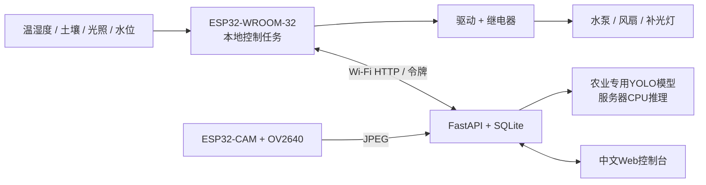

# ESP32 智慧农业系统：感知、控制、病虫害识别

面向**单区温室/盆栽原型**的完整业务源码。包含ESP32环境控制器、ESP32-CAM采图固件、Python后端、SQLite存储、中文Web控制台、农业YOLO模型训练/推理入口、器件清单、接线说明及测试。

**重要边界：农业专用模型权重和真实标注数据不在本包中。** 配好硬件和服务后可采集环境、控制设备、查看和上传图片；病虫害识别需要按目标作物训练并加载 `best.pt`。未加载模型时界面显示“未配置模型”，不会产生虚构的识别结果。整套系统尚未连接真实硬件验证。

## 先看这些文件

- [完整器件清单](docs/BOM.md)：数量、规格、供电、驱动和替代选型。
- [接线与标定](docs/WIRING.md)：全部GPIO、继电器驱动、水泵供电、烧录与验收顺序。
- [病虫害数据、训练、部署](docs/AI.md)：类别示例、YOLO标注、训练及独立测试。
- [接口说明](docs/API.md)：设备/相机/管理员权限和数据格式。
- [验证记录](docs/VERIFICATION.md)：实际运行过的检查与尚未验证的环节。

## 系统架构



两块板不是同一块：主控负责可靠的传感和控制，相机单独拍照上传。服务器用现有电脑即可，手机浏览器可打开同一局域网内的控制台。

### 已实现的功能

| 模块 | 功能 |
|---|---|
| 环境感知 | DHT22温湿度、模拟土壤相对湿度、BH1750光照、浮球水位；约2.5秒采样、10秒上报 |
| 智能灌溉 | 土壤低阈值开泵/高阈值停泵、默认15秒单次限时、默认300秒停泵冷却 |
| 通风/补光 | 温度回差启停风扇、光照回差启停补光；阈值网页可改 |
| 人工控制 | 开/关/恢复自动；临时指令到期后回到本地策略，安全联锁优先 |
| 断网工作 | 本地控制独立运行，策略保存NVS；传感数据超过10秒未刷新则按故障处理 |
| 水泵保护 | 缺水/水位断线、土壤无效/过期、连续运行超时停泵；网络阻塞不阻止100ms控制任务 |
| 模型管线 | 摄像头约60秒上传、手动图片上传、目标检测框/置信度展示；训练需自备数据 |
| 管理界面 | 实时状态、湿度趋势、策略配置、设备在线/离线、策略版本确认、操作记录 |
| 数据管理 | SQLite；保留最近10000次遥测、200张图片；页面最近120次采样/12张图 |

初次开机**自动控制关闭**。启用自动后策略会保存并跨重启恢复。手动关闭是有时效的，时效结束后可能按自动策略重新开启；检修请断开负载电源，不能把网页按钮当作物理隔离开关。补光目前没有昼夜时程，按光照低阈值启动；长期种植应按作物光周期扩展时程。

## 目录

```text
firmware/controller/     PlatformIO控制器工程
firmware/camera/         PlatformIO摄像头工程
server/app.py            FastAPI接口、认证、存储、图片推理
server/static/           中文Web控制台（无前端构建依赖）
ai/                     数据集配置、训练与数据检查脚本
tools/generate_env.py    生成三个独立随机令牌
tests/                  API与可移植控制逻辑测试
docs/                   器件、接线、AI、接口、验证说明
compose*.yaml            基础/AI Docker部署
```

## 第一步：启动服务

所有命令从解压后的 `smart-agriculture` 根目录执行。

### Docker（基础功能）

```bash
python3 tools/generate_env.py
docker compose up --build -d
```

打开 `http://服务器局域网IP:8000`，把 `.env` 中的 `ADMIN_TOKEN` 输入管理页。`.env` 属于本地凭据，不要上传或发给他人。数据库位于Docker具名卷 `farm-data`；重建容器不会删除卷，备份可通过Docker卷工具完成。

此基础镜像不包含神经网络依赖。需要识别时按 [AI文档](docs/AI.md) 使用 `Dockerfile.ai + compose.ai.yaml`。

### Python本地运行（macOS / Linux）

推荐Python3.11；基础服务也已在本机Python3.13上执行接口测试。

```bash
python3.11 -m venv .venv
source .venv/bin/activate
pip install -r server/requirements.txt
python tools/generate_env.py
set -a
source .env
set +a
uvicorn server.app:app --host 0.0.0.0 --port 8000 --workers 1
```

仅运行一个worker；图片队列和模型在单进程内串行保护。数据库与图片默认位于 `server/data/`，可通过 `DATA_DIR` 改位置。打开防火墙的局域网8000端口，给服务器配置固定局域网IP。相机和主控配置里不能写 `localhost`，那会指向板子自身。

Windows可以优先使用Docker Desktop；Python方式的启动命令为：

```powershell
py -3.11 -m venv .venv
.\.venv\Scripts\Activate.ps1
pip install -r server/requirements.txt
python tools/generate_env.py
Get-Content .env | ForEach-Object { $pair = $_ -split '=',2; if ($pair.Length -eq 2 -and -not $pair[0].StartsWith('#')) { [Environment]::SetEnvironmentVariable($pair[0], $pair[1], 'Process') } }
uvicorn server.app:app --host 0.0.0.0 --port 8000 --workers 1
```

重复运行生成器会拒绝覆盖已有 `.env`，保留原凭据即可。

## 第二步：配置、编译和刷写两块板

安装VS Code + PlatformIO扩展，分别打开 `firmware/controller` 和 `firmware/camera` 工程。也可以在Python环境中 `pip install platformio==6.1.18` 后使用命令行。

分别把各自 `include/config.example.h` 复制成同目录 `config.h`，填写：

1. 相同的2.4 GHz Wi-Fi名称、密码。
2. `SERVER_URL`：例如 `http://192.168.1.100:8000`，末尾不要加 `/`。
3. 主控填 `.env` 的 `DEVICE_TOKEN`，相机填 `CAMERA_TOKEN`。网页只使用ADMIN_TOKEN。
4. 主控确认继电器触发方式和土壤干湿标定值。默认高电平触发，对应本文分立NPN驱动。

macOS/Linux复制与构建示例：

```bash
cp firmware/controller/include/config.example.h firmware/controller/include/config.h
cp firmware/camera/include/config.example.h firmware/camera/include/config.h
# 此时先编辑两个config.h，填写自己的网络和令牌，再编译
pio run -d firmware/controller
pio run -d firmware/camera
pio run -d firmware/controller -t upload
pio run -d firmware/camera -t upload
```

必要时追加 `--upload-port` 指定串口。使用 `pio device monitor -b 115200` 看日志。ESP32-CAM的GPIO0下载跳线步骤见 [接线说明](docs/WIRING.md)。

固件依赖固定PlatformIO Espressif32 6.9.0 / Arduino-ESP32 2.0.17，避免随意升级核心后相机接口变化。首次构建需要联网下载工具链和依赖。

## 第三步：标定、验收、启用自动

先按 [接线说明](docs/WIRING.md) 在断开负载时完成传感器验证、GPIO映射、水位方向和土壤两点标定。按顺序验证手动开关、缺水停泵、土壤断线停泵、限时停泵和断网控制。初次启动水泵要等默认300秒冷却期结束，网页会显示冷却状态。

网页保存策略约3秒轮询后应用；看“服务器策略版本”和“设备回报版本”一致，再确认实际执行状态。遥测约10秒一次，网页约5秒刷新；这不是秒级紧急停机系统。

## 第四步：病虫害模型

看 [AI文档](docs/AI.md)，准备现场数据与标注，执行 `ai/train.py` 并审核独立测试指标，把 `best.pt` 挂载或通过 `MODEL_PATH` 加载。示例类别为番茄早疫病、晚疫病、叶霉病、蚜虫、粉虱、潜叶虫，可修改数据类别重新训练。

模型不自动驱动喷药或施肥。没有目标框不等于作物健康。项目没有预设准确率，也没有把未训练权重当作农业模型交付。

## 测试

```bash
pip install -r tests/requirements.txt
python -m pytest tests/test_api.py -q
python -m pytest tests/test_dataset.py -q
c++ -std=c++11 tests/test_control.cpp -o /tmp/farm-control-test
/tmp/farm-control-test
```

API测试使用临时数据库，覆盖权限分离、传感数据、策略回差、临时指令过期、图片有效性和无模型状态。C++测试覆盖水泵限时/冷却、缺水保护、故障、回差和millis计数溢出。实物接线、ADC精度、继电器抗干扰和模型准确率仍需现场验证。

## 运行边界

- 此版本固定一个控制器 `farm-01` 和一个相机角色，适合毕业设计、演示和单区原型；多棚需扩展设备注册、独立策略、设备级密钥与数据隔离。
- HTTP用于可信隔离局域网，令牌不加密传输；不要直接端口映射到公网。远程使用应增加VPN或TLS网关，固件目前使用WiFiClient，不能只把URL改成https就认为已支持TLS。
- 土壤开路下拉只能提高检出概率，不能检测全部传感器故障；水泵干转/水管堵塞/继电器粘连需要流量及硬件保护，当前没有流量反馈。
- 操作记录暂不自动清理；遥测和图片滚动保留，长期历史应先做备份/归档。

## 官方参考

- [ESP32 ADC API](https://docs.espressif.com/projects/arduino-esp32/en/latest/api/adc.html)
- [ESP32相机驱动](https://github.com/espressif/esp32-camera)
- [固定Arduino版本的相机引脚定义](https://github.com/espressif/arduino-esp32/blob/2.0.17/libraries/ESP32/examples/Camera/CameraWebServer/camera_pins.h)
- [PlatformIO ESP32 Dev Module](https://docs.platformio.org/en/latest/boards/espressif32/esp32dev.html) / [ESP32-CAM](https://docs.platformio.org/en/latest/boards/espressif32/esp32cam.html)
- [Ultralytics检测数据](https://docs.ultralytics.com/datasets/detect/) / [训练](https://docs.ultralytics.com/modes/train/)
- [PN2222A数据手册](https://www.onsemi.com/pdf/datasheet/pn2222a-d.pdf)

自写代码按MIT许可提供；第三方库、模型和数据遵循各自许可。
